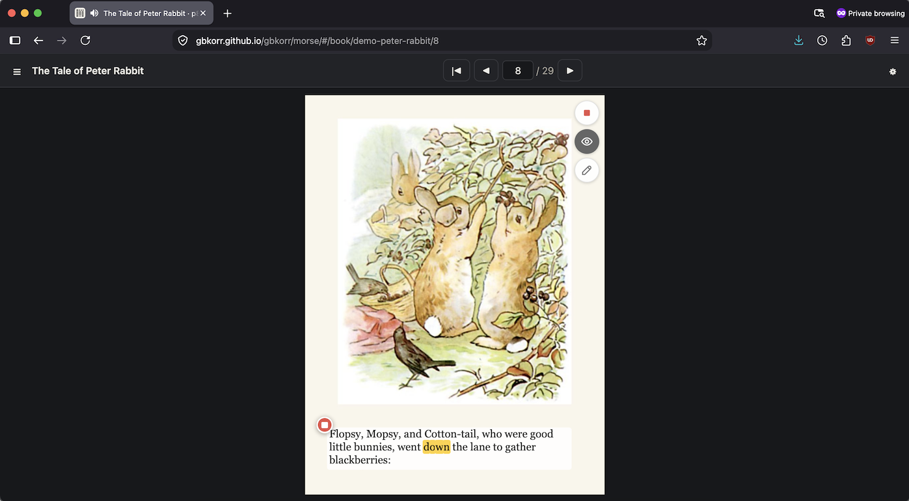

This short article is a bit of a reflection on a new tool I made for using Morse, and the new reality of making software in-house.

## Morse Reader
The tool I made addresses a gap I saw in the learning resources for Morse code: lots of websites let you translate text, but none of them combine that text with images like children's books do. This sort of combination provides context and interest, and typically makes it quite a bit easier and more engaging to learn a language.

So I had Claude build a little website that takes PDF uploads, extracts the text with OCR, and converts it into blocks of playable Morse[^set]. A little UX tweaking later and I had a nice, simple, useful, *shippable* tool in about an **hour** of work. What a time to be alive!

[^set]: With the typical controls for Morse WPM, frequency, tone, etc. These are pretty important— I'm picky about how my morse sounds!

The tool is intended to be used with Dr. Seuss books[^glaze], but I can't ship it with them due to copyright; you'll have to find your own Seuss PDFs to import. You can also upload non-picture-books, but that's boring :P. PDFs are saved locally in the browser, so you don't have to reimport them every time you visit the page.

You can find the website here: [https://gbkorr.github.io/gbkorr/morse](https://gbkorr.github.io/gbkorr/morse)

[^glaze]: Some of the most entertaining children's books out there! The rhyming is also quite helpful for learning morse. 

## Bespoke Development
This project really got me thinking about how easy it is to build useful code now. It really is the age of **bespoke development**— it's *easier* to make most tools in-house than to properly fork an existing project[^fork], now that AI is so efficient at coding. This has some unexpected benefits— the tools may end up *more* secure or well-coded than if they were forked, since much of the preexisting human OSS code is... improvable, let's say. 

[^fork]: Often this in-house work will involve referencing existing OSS projects, but that's still quite different from a fork or branch.

The downside is that these in-house projects end up disaggregating the tools and ideas that would otherwise be stored in one big, utility-porkbellied OSS project, but since these tools and ideas are relatively simple to come up with from scratch now (that's the whole idea here), I'm not sure this is too bad.

All of this applies less and less as the software in question gets more complicated or difficult. Anything that *can't* be easily figured out on its own, or for which there's an obscure, better solution, will really benefit from an OSS reference or paper. And large projects— especially those that require good UX, as mentioned below— need the continuous user testing that centralized OSS provides.

## Open-Source Software
What does this mean for OSS in general? Well, it's much easier for an AI to read, test, and adapt premade code than to do *all* the exploratory work on its own. Thus, it's still valuable for code to be open-sourced— moreso as an token/speed saving than anything else. Of course, for software that's had a high degree of QA/user testing (like a popular GUI tool), the UX will be much stronger than one made on-the-spot, and this sort of software is usually worth forking (and maybe redoing the backend of).

