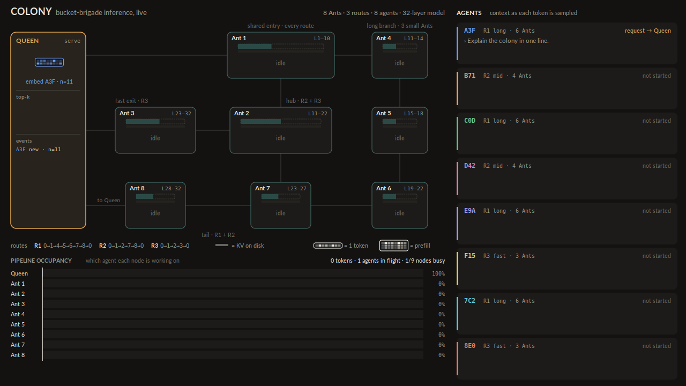
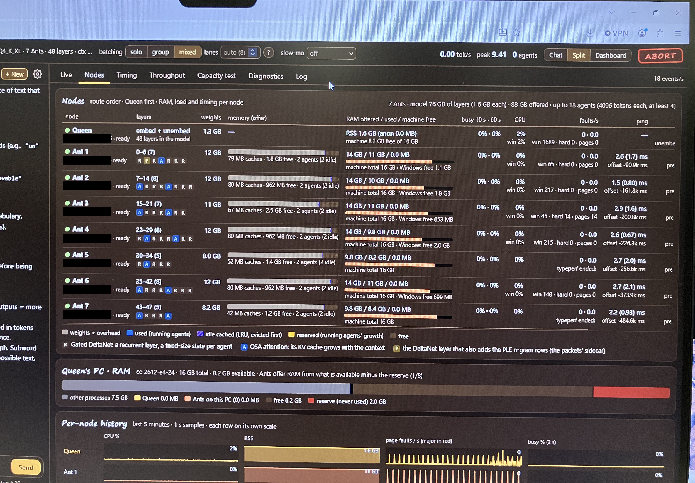
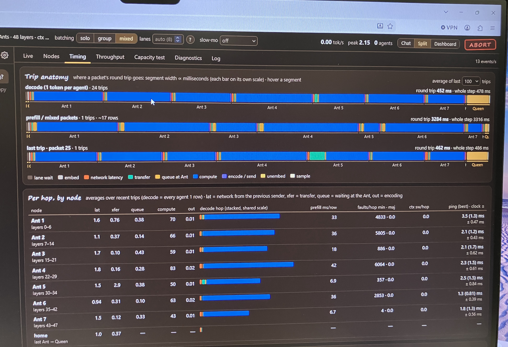
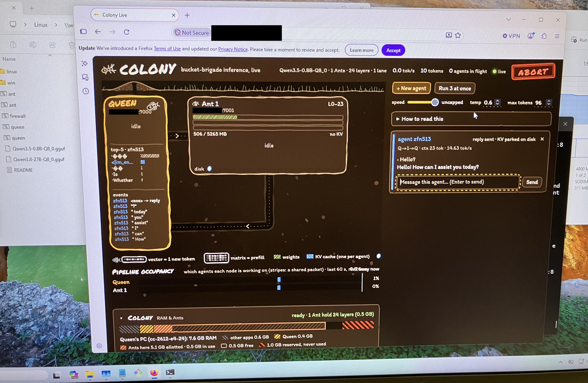

Here's a project I worked on for most of October. The idea is to have a protocol for distributed, "bucket-brigade inference", where each machine contains only part of a GGUF and the network passes a token's activations through each node to generate the next token. 

I got it working, with the computer lab computers able to join the network and run inference just by running a .bat file served by the other nodes. But the inference ended up being so slow that I couldn't come up with anything interesting to do with the network...

Anyway, here's some details about the protocol. This one felt a little weird to write compared to some of the other articles I've made, but maybe it'll be interesting.

## Distributed Inference

Distributed inference is a bit of a canonical idea— both in general (Anthropic made a post about it recently) and as a solution to the RAM issue. "If you need the whole model in RAM and don't have enough RAM on one machine, why not split the model between multiple machines?" The time cost of transfering data between machines during inference is actually minimal, so this is more feasible than you might think— it's not much that worse than running inference on a single machine.

Where it really gains something is in parallelization— unlike a single machine, which can only stream its weights out of RAM for one token at a time, the machines on a distributed inference network can all stream their weights at once. Practically, this means *each node can run inference on a separate token*, all at the same time. But... inference is serial, so these tokens can't belong to the same conversation. But this still allows for a much higher token throughput when the network is running inference for **multiple agents at once**. 

There are several preexisting frameworks for distributed inference— including one that already ships with llamacpp— but Colony focuses specifically on being lightweight and easy to set up, and on taking advantage of that multi-agent throughput.

## Specification
In a Colony network, all nodes are **Ants** except for one **Queen**.

The Queen exposes the /v1 inference API and handles tokenization and sampling. The Ants just perform inference, each using a different slice of the model weights.

To generate a token, the Queen sends the activations (embedded vector or prefill matrix) to Ant 1, which runs it through its layers and passes it to Ant 2. This continues through every layer until it gets back to the Queen.

Critically, this allows, for example, Ant 1 to inference for agent B while Ant 2 is inferencing for agent A— multiple agents can run their activations through the network at once because each agent's activations are only present on one node at a time (hence the "bucket-brigade" description). Combined with batching (where multiple agents' activations are combined into one matrix so a node can inference on several at once), the Colony's agent throughput can get very high, many times past the number of nodes.

To initialize the Colony network, each node needs to obtain its designated layer weights; this is most easily achieved by having the Queen download the target GGUF, slice it itself, and send the weight slices to each connected Ant to save on disk.

Load balancing is left out of scope of the specification, as it's easy to adapt the system to be centralized (e.g. controlled by an external machine, website, botnet controller, etc.) or decentralized (decisions made by quorum among the active machines).

When a node goes inactive, its context can be recovered by running the entire context through a new route as prefill (after reapportioning the weights), though this is very slow. Preferably, assume nodes won't go inactive and treat their context as lost if they do.

## Setup
This sort of system is quite robust, since it lives on RAM; all you need is a file on each node that reserves the RAM, runs inference, and listens for the activations and weights from other nodes. In the computer lab I was in, I was able to get machines to join the network just by running an unpriviledged .bat file that installed WSL (not subject to the same .exe restrictions these computers had) and ran the code for the node.

Colony would work in a browser, but I wouldn't recommend it— it's already slow enough as-is, and browsers are much more unstable/likely to drop out of the network. I'm planning a new distributed inference protocol that's more robust to that sort of thing, but it's still in the early stages.

## Performance

Turns out you can't escape the Tyranny of RAM. This system, like anything for inference[^except], is limited by the speed its computers can stream the weights out of RAM into the CPU for every token. And there's... not really anything to be done about it :(

[^except]: Except tensor parallelism, which is a gimmick that doesn't really do much.

I got around 2tps on QFN[^qfn] due to the sheer size of the model— even with just 6B active weights, it still takes hundreds of milliseconds to stream all of them through. Weaker models were a bit faster, but they're not great at what they do. This RAM issue makes fast inference with big models basically impossible on weaker consumer hardware— perhaps that's for the better if you're scared about your smart TV being commandeered, but it means Colony can only be useful as a rather slow protocol for inference. (Unless you're targeting stronger computers, but that's the 99th percentile of hardware out there.)

[^qfn]: https://huggingface.co/Qwen/Qwen3.8-Flash-Next

MTP can up to double the speed of inference, but it's still not great at 2 -> 4 tps. Lower quants reduce the amount of data held in RAM, but reduce the model's intelligence— quantizing for better performance is a slippery slope.

## Utility

So... what the heck do you do with a swarm of 2-tps agents? That's where this project ends— I never figured out a good answer!

Specifically, most agentic tasks aren't particularly parallelizeable— writing and debugging code takes a lot of single-thread back-and-forth— and the things that are, like bulk reading, end up compute-bound anyway (the network can only process so much prefill at once). And that's all on top of thinking signficantly increasing the time each response takes, which makes the practical speed even slower than 2tps.

## Prototyping with Claude

This was a good opportunity to experiment with AI for rapid prototyping and development. I wrote up the specification above (with a good bit more detail) and first asked Claude to visualize it:

This quite accurately captured what I was going for, so I was confident continuing knowing that it was understood correctly. This also got adapted into the later UI, since it was a good way of visualizing what's going on. 

Then, lots of testing in the computer lab. I eventually asked for the UI to have a graphical suite for diagnostic information. I received many more graphs than I expected, but was surprised to find out that most of them were useful (to me, in testing). This isn't the sort of thing I'd ship but it was very helpful.

{.lightbox width=300} {.lightbox width=300}

Before that, I had gotten sick of the default Claude aesthetic and suggested changing it to a sort of intentionally kitschy ant theming. It's amazing how much a silly difference like this (or a new IDE, etc.) can change the vibe of a project you're working on.

## Release?

I don't think I'll be releasing the files for this, unless there's some demand. Why? Well, it's sort of just slop without a **clear purpose**. When I release something, I like it to be well-tailored to its use case (this doesn't have a good use case), or particularly novel. Distributed inference in general isn't novel, and while this sort of bucket-brigade inference might actually be, the specification is what contains the novelty— not the code. As I did in this project, you can implement Colony for yourself by just feeding Claude the specification. I had it use the ggml libraries for efficient inference (no reason to [build my own inference engine](../ggufr/ggufr.qmd) again), but any approach to inference works as long as you can pull out the activations to send to the next node.

