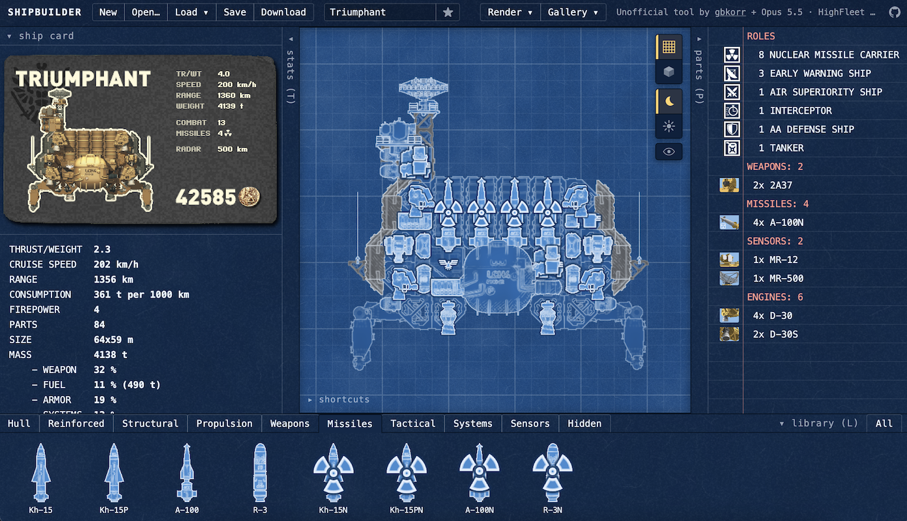
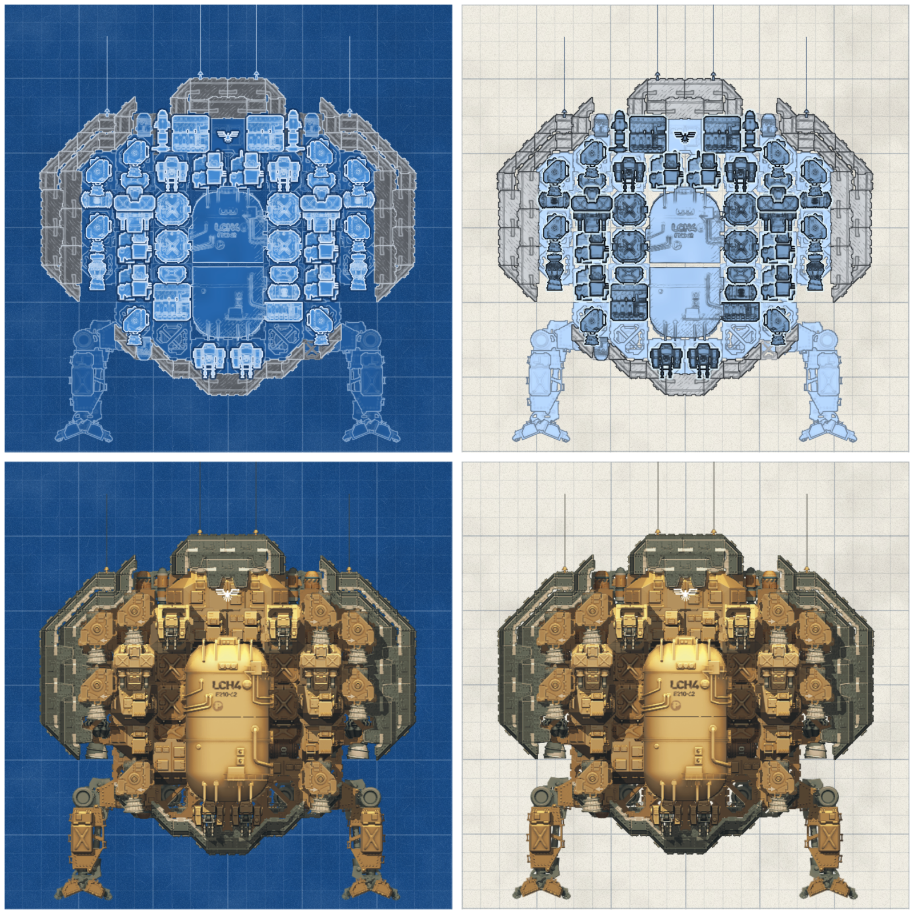
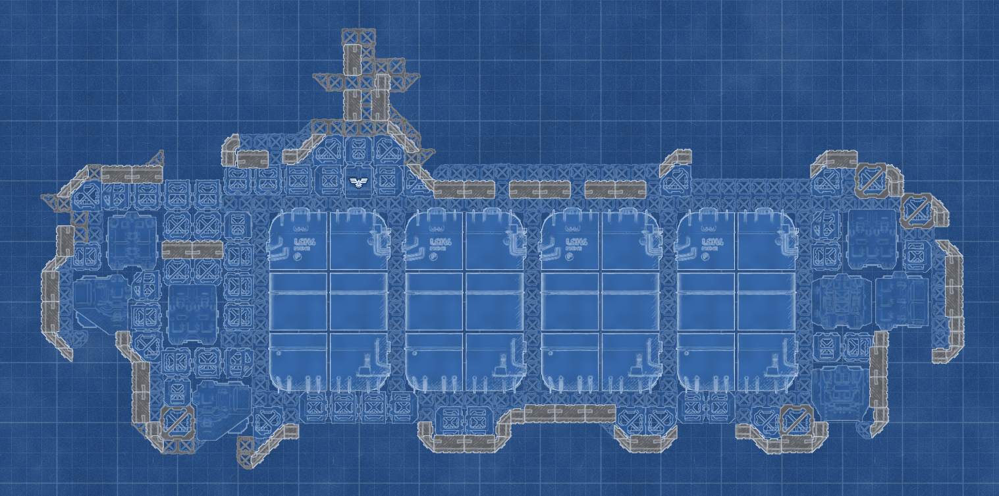
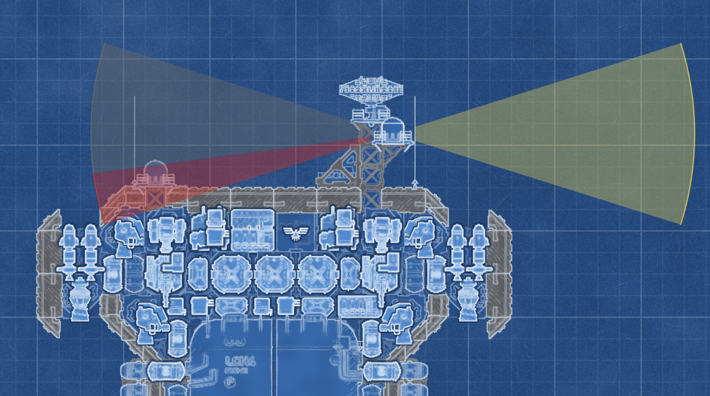
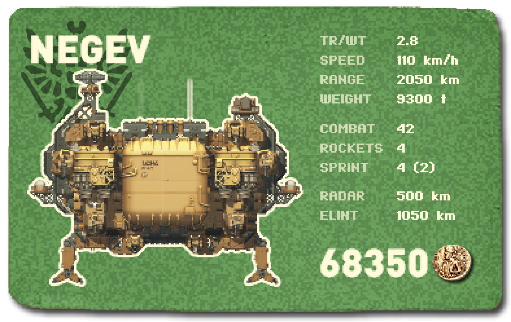
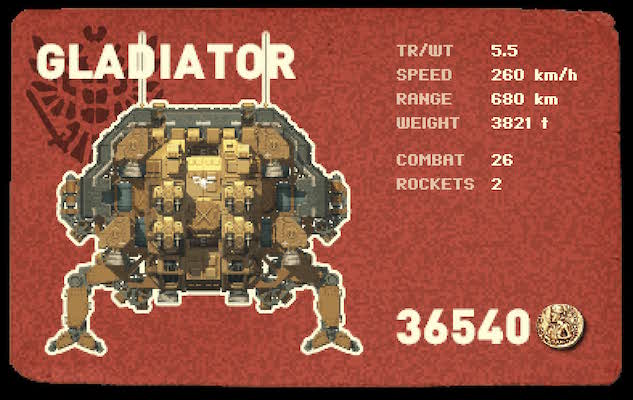
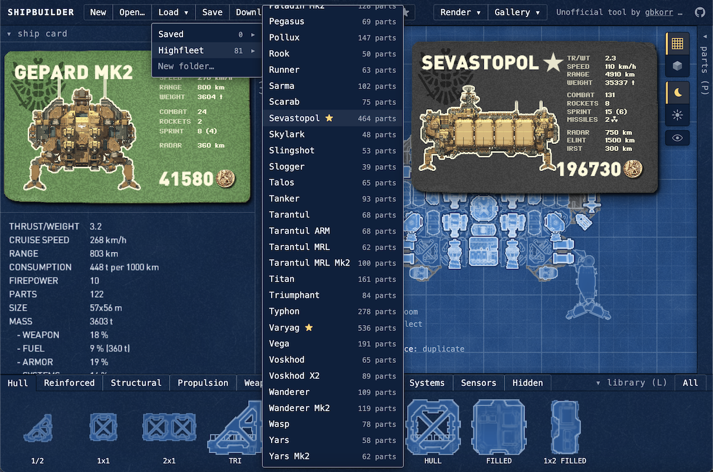
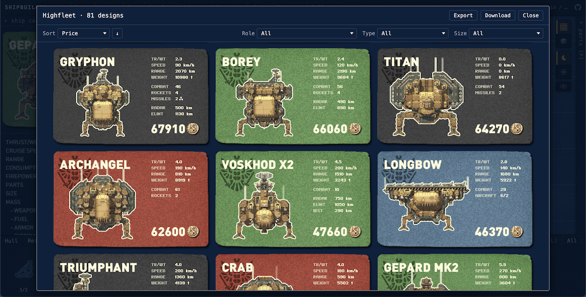
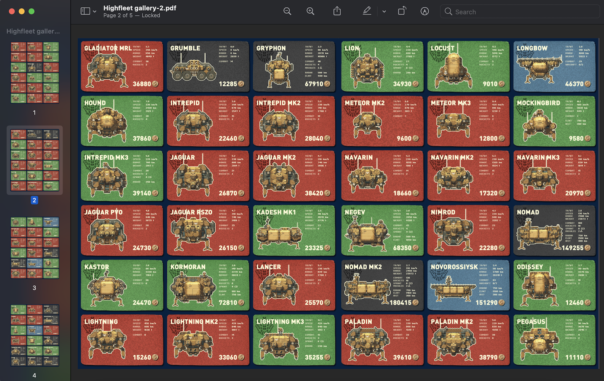
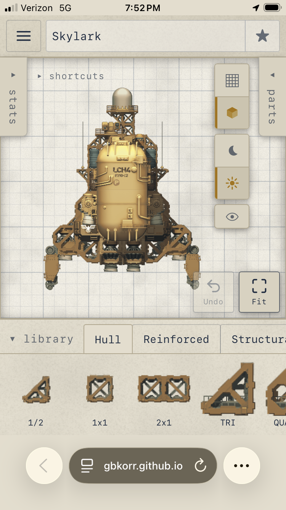

This article is an overview of a tool I created for one of my favorite video games, [Highfleet](https://store.steampowered.com/app/1434950/HighFleet/). I wanted to use the game's ship creator on the go my laptop (without having to boot the whole game), and this also gave me an opportunity to improve on the editor, which in the game is pretty bare-bones.

[**LINK TO THE SHIPBUILDER**](https://gbkorr.github.io/khivashipworks)

The webapp was **100% coded by Opus 5.5**. I took this as an opportunity to practice my AI web development, staying completely hands-off the code and only focusing on QA and design. It took several weeks of polish, as well as some community feedback— I had a working shipbuilder and renderer within a day and the rest was all polish and iteration. I also asked for a refactor and cleanup late in the process, which turned the codebase from experimental clutter into a neat working space for release.

This project is particularly fun because there's **actually a need** for it— as mentioned, the ingame editor is somewhat simple and inconvenient (especially for sharing designs), and being able to access it on any device is a big convenience. The project had a very positive reception when I shared it with the game's community.

## Features
Features were carefully chosen to avoid bloat— every feature (and omission) exists for a reason and is useful, imo. 

### Shipbuilder

The core of the app is the ship editor, which copies the game's basic editor and adds a lot of QoL.

The editor has two rendering modes: a full ship render as seen ingame, and a tactical blueprint view that shrinks and standardizes parts to make it much easier to keep track of a ship's armaments and modules. There's also a light/dark mode toggle.

The editor has roughly the same controls as ingame, along with multi-select, undo, and several other utilities. I changed right-click to pan to make it easier to quickly navigate around the ship (now left+right click = delete). I also added a button to hide a ship's modules, to make it easier to inspect the hull structure.

Part placement and stats logistics almost fully match ingame, including accurate radar occlusion. The UI includes the stats shown in the ingame editor (plus a few more new stats), as well as a list of parts. All UI bars are collapsible. All text (aside from the ship cards) is rendered natively in HTML so the page can be translated by the browser— a decent chunk of the playerbase plays in Russian.

### Card Imports
The ship cards are definitely my favorite part of this project. They're based on the ship cards seen ingame, but with a big change: the cards themselves **encode the ship design in the image**, via some clever compression and error coding. This was done to address a big issue with sharing designs— people online used to have to provide a very clunky google drive download for a ship's .seria file if they wanted to share a design they made. Now, they can share a design *with the same image they're using to show it off*— so much more convenient!

The system is robust to JPEG compression and screenshotting, so you can send these very easily over messaging systems (though particularly large designs are less likely to be recoverable). The system orients itself off of the Highfleet stamp in the top-left as well as the coin used for the price.

{width=400}

The stats shown on the ship cards are also a bit more useful than the ones ingame.

### General Tools
The webapp has a full file management suite for designs, allowing designs to be saved offline into custom folders (which can be renamed, merged, copied, etc.). The Load menu also shows ship card previews of each design on hover. I included all the game's default designs in the website for reference and customization, like the ingame shipbuilder does.

Designs and folders can also be imported and exported as `.seria` files for use ingame (the game saves and loads designs from `C:\Program Files (x86)\Steam\steamapps\common\HighFleet\Ships`).

I also added a way to visualize folders of designs based on the ship selection screen at the start of the campaign. Using the `Gallery` button in the top bar opens a gallery of ship cards for the selected folder, with filters and sorting. The filters are pretty fun for exploring the game's prebuilt designs.

The gallery also gives the option to export the folder as a PDF of images (18 per page) for easy sharing; the PDF also includes design metadata, so you can **directly import the PDF as a folder of designs**, making it the best way to share a collection of ships.

## Mobile
The webapp also features a full mobile mode, which was surprisingly trivial to add. It's a little clunky (to be expected for a complex editor like this) but still quite usable.

{width=300 fig-align="center"}

## Optimizations
Significant effort was put into making this webapp as smooth and lagless as possible. 

The game's rendering engine is somewhat computationally expensive (especially due to shadow recalculations), which can be seen in both the web editor and the game itself; any changes to the Sevastopol cause a half-second of lag. This lag can be entirely avoided by using the Blueprint mode (which doesn't utilize the shading pipeline), making work on large designs much more convenient.

For the ship cards, I had Claude change the rendering pipeline such that *the render on the ship card can be interrupted*— this allows the card to be loaded without lagging the page at all, which is very important when skimming the design menu or making frequent changes in the editor. This is also why it can take a couple seconds for the ship card to update after a part is placed.

Otherwise, the rest of the editor is simple and shouldn't be any trouble for browsers to run.

## Limitations
I didn't include part info (shown on hover in the ingame editor— weight, cost, etc.), but I should probably add that at some point.

There are several niche mechanics I intentionally left out— their omission allows for a few minor things that wouldn't be possible in the ingame editor, but the ships will still work ingame when imported. These are:

- missile and flare occlusion
- power routing cutoff when not connected by hull
- circular engine overlap checks

:::{.hidden}
notes/todo:
panning bug? with WASD and rightclick
allow copy folders
rendering: only render areas affected (raised, etc.) by the change; should make seva easier to work with
:::

